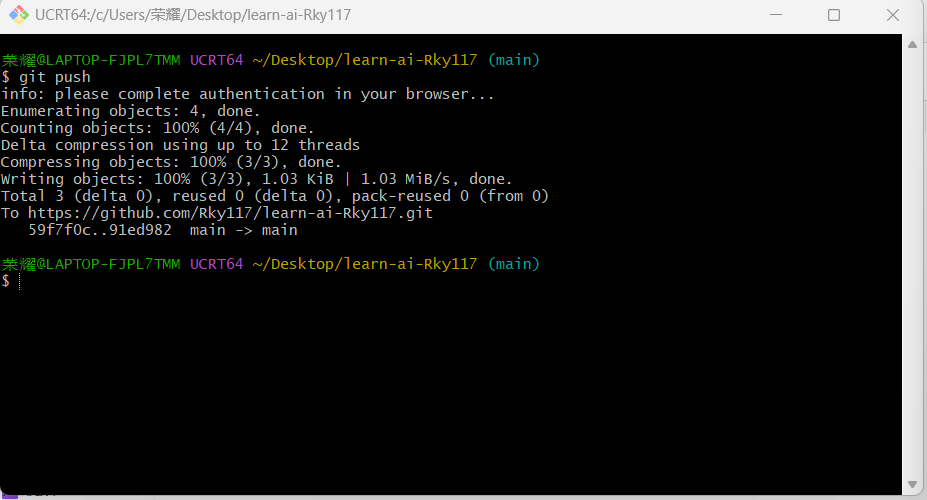

# 疯狂的一天

## 今日学习记录

### 学习任务

本次作业练习 Git 的基础操作，并完成第一份 Markdown 文档的编写与推送。



### 使用到的 Git 命令

下面是本次执行的全部命令：

```bash
# 克隆远程仓库到本地
git clone https://github.com/Rky117/learn-ai-Rky117.git
# 进入仓库目录
cd learn-ai-Rky117
# 把文件加入暂存区
git add .
# 提交并填写说明
git commit -m "docs: add crazy-day.md"
# 推送到远程仓库
git push
```

## Git 命令对照表

| 命令 | 作用 |
| --- | --- |
| `git clone` | 把远程仓库完整下载到本地 |
| `git add` | 把文件改动加入暂存区 |
| `git commit` | 把暂存区内容提交成一次版本记录 |
| `git push` | 把本地提交推送至远程仓库 |

## 参考资料

- [Git 官方文档](https://git-scm.com/doc)
- [Markdown 基本语法](https://markdown.com.cn/basic-syntax/)
- [西二在线 AI 考核指南](https://github.com/west2-online/learn-AI)

## 小结

今天走通了 Git 的完整工作流：克隆仓库、编写文件、加入暂存区、提交、推送，并理解了暂存区与本地仓库的区别。
